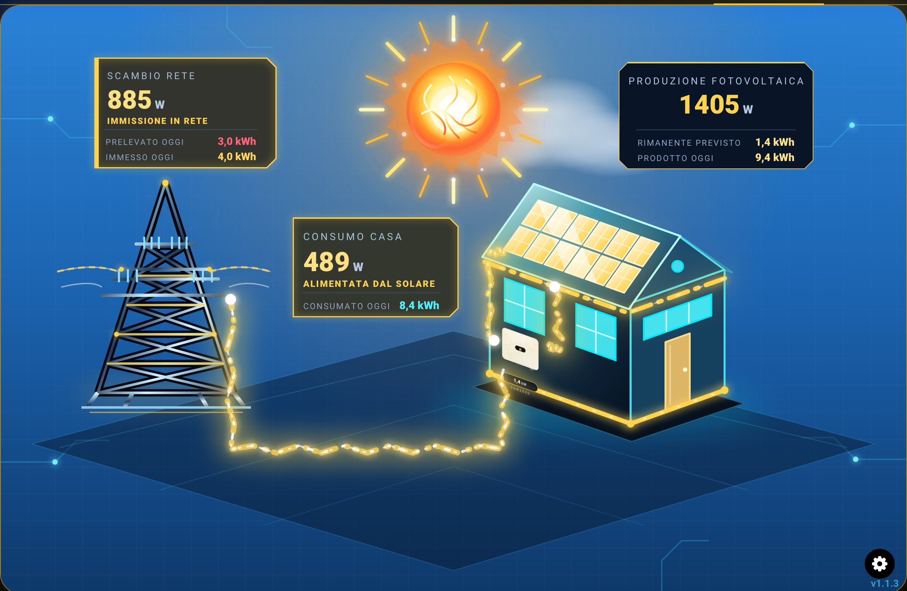
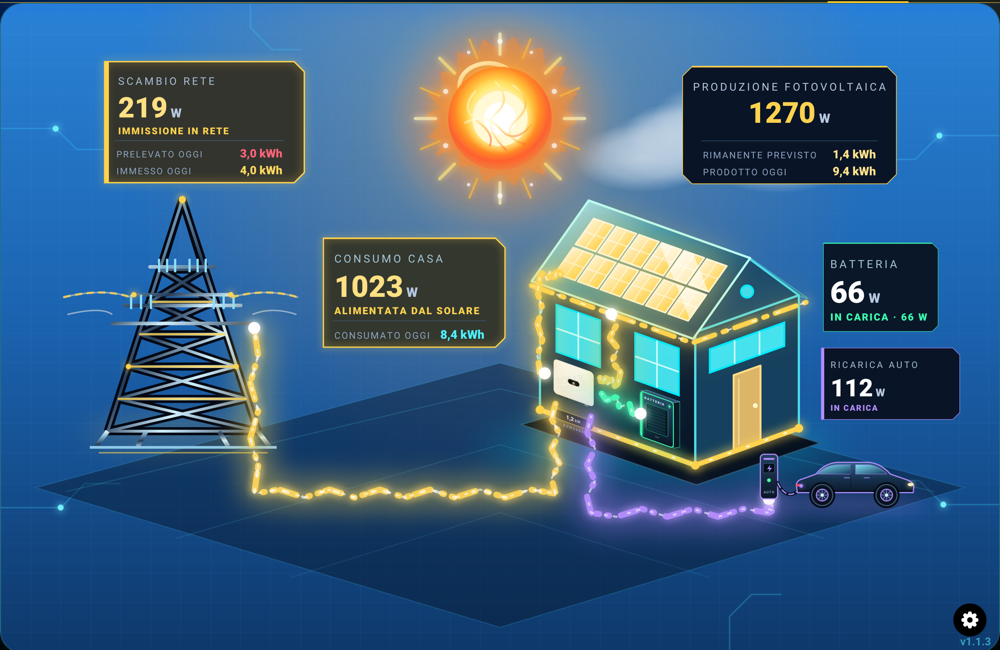

# ☀️ Sunmoon Energy Card

**Una card Lovelace personalizzata per Home Assistant che trasforma i dati energetici della casa in una scena animata.** Produzione fotovoltaica, consumi, scambio con la rete, meteo, ciclo giorno/notte e, se configurati, batteria di accumulo e ricarica dell'auto elettrica.

La card include un **editor visuale** per configurare sensori, colori, immagini, dimensioni e posizione degli elementi direttamente da Home Assistant.

<p align="center">
  
</p>

<p align="center"><em>Vista principale: produzione fotovoltaica, scambio con la rete e consumo della casa.</em></p>

<p align="center">
  
</p>

<p align="center"><em>Vista con batteria di accumulo e ricarica dell'auto elettrica.</em></p>

---

## 🇮🇹 Documentazione in italiano

### ✨ Funzionalità

- **Scena energetica animata** con sole, cielo, luna, traliccio elettrico e abitazione.
- **Flussi energetici dinamici** per produzione fotovoltaica, prelievo dalla rete, immissione in rete e consumo domestico.
- **Riquadri informativi** per potenze istantanee e totali giornalieri.
- **Nodo centrale personalizzabile** con tre modalità: inverter, nucleo/reattore oppure flussi diretti senza nodo.
- **Meteo animato**: nuvole, nebbia, pioggia, temporali, grandine, neve e vento in base alla condizione dell'entità meteo.
- **Ciclo giorno/notte** con sole e luna; supporto all'entità `sun.sun` o a sensori di alba e tramonto.
- **Batteria di accumulo opzionale** con potenza, stato di carica e totali giornalieri di carica/scarica.
- **Auto elettrica opzionale** con potenza, stato di carica ed energia giornaliera.
- **Editor visuale integrato** per selezionare le entità e personalizzare colori, etichette, immagini, dimensioni e posizione degli elementi.
- **Anteprime meteo e notte** disponibili nell'editor per provare l'aspetto della scena.

Le funzioni relative a batteria, auto, meteo e totali vengono visualizzate quando vengono configurate le relative entità. La card non crea sensori e non sostituisce le integrazioni del tuo impianto.

### 📋 Requisiti

- Home Assistant con dashboard Lovelace.
- Un'installazione funzionante delle integrazioni che forniscono i dati energetici.
- Entità di Home Assistant per i valori che vuoi visualizzare.
- Nessuna integrazione Python `custom_components` è necessaria: questa è una **custom Lovelace card** basata su JavaScript.

Non è necessario disporre di tutti i sensori: le sezioni non utilizzate possono rimanere non configurate.

### 📦 Installazione con HACS

1. Apri **HACS** in Home Assistant.
2. Vai in **⋮ → Repository personalizzati**.
3. Incolla l'URL GitHub di questo repository.
4. Seleziona la categoria **Dashboard** e conferma.
5. Cerca **Sun Moon Energy** in HACS e installala.
6. Se HACS non registra automaticamente la risorsa, aggiungila da **Impostazioni → Dashboard → Risorse** come JavaScript di tipo **Modulo**, usando il percorso indicato da HACS. Normalmente il percorso è:

   ```text
   /hacsfiles/sunmoon-energy/sunmoon-energy.js
   ```

7. Aggiorna la dashboard. Se necessario, svuota la cache del browser.

> Il repository deve essere pubblicato su GitHub prima di poter essere aggiunto come repository personalizzato in HACS.

### 🧰 Installazione manuale

1. Scarica il file `sunmoon-energy.js` dalla sezione dei file del repository.
2. Copialo nella cartella `/config/www/` di Home Assistant.
3. Apri **Impostazioni → Dashboard → Risorse**.
4. Aggiungi una risorsa con URL:

   ```text
   /local/sunmoon-energy.js
   ```

5. Imposta il tipo di risorsa su **Modulo** e salva.
6. Aggiorna la pagina di Home Assistant.
7. Aggiungi una nuova scheda manuale alla dashboard e seleziona il tipo `custom:sunmoon-energy`.

### ⚡ Sensori ed entità

Gli entity ID riportati sotto sono esempi: devi sostituirli con quelli presenti nella tua installazione. Puoi selezionare le entità dall'editor visuale oppure inserirle nella configurazione YAML.

| Opzione YAML | Dato richiesto | Unità tipica |
|---|---|---|
| `solar_power` | Potenza fotovoltaica istantanea | W |
| `home_power` | Potenza istantanea assorbita dalla casa | W |
| `grid_power` | Potenza di scambio con la rete | W |
| `solar_forecast_remaining` | Produzione residua prevista | kWh |
| `solar_total_today` | Energia fotovoltaica prodotta oggi | kWh |
| `grid_import_today` | Energia prelevata oggi dalla rete | kWh |
| `grid_export_today` | Energia immessa oggi in rete | kWh |
| `home_total_today` | Energia consumata oggi dalla casa | kWh |
| `weather_entity` | Entità meteo di Home Assistant | — |
| `sun_entity` | Entità sole, normalmente `sun.sun` | — |
| `sun_rising` | Sensore orario alba | — |
| `sun_setting` | Sensore orario tramonto | — |
| `battery_power` | Potenza della batteria | W |
| `battery_soc` | Stato di carica della batteria | % |
| `battery_charge_today` | Energia caricata nella batteria oggi | kWh |
| `battery_discharge_today` | Energia scaricata dalla batteria oggi | kWh |
| `car_power` | Potenza di ricarica dell'auto | W |
| `car_soc` | Stato di carica dell'auto | % |
| `car_energy_today` | Energia di ricarica dell'auto oggi | kWh |
| `hub_entity` | Entità di potenza associata al nodo centrale | W |

**Attenzione a unità e segno dei sensori:** le integrazioni possono esprimere la potenza di rete con convenzioni differenti. Se il flusso di prelievo e quello di immissione risultano invertiti, utilizza `grid_invert`. Per la batteria è disponibile `battery_invert`.

### 🧩 Configurazione YAML

La card può essere configurata interamente dall'editor visuale. In alternativa, puoi usare una configurazione YAML.

Esempio essenziale:

```yaml
type: custom:sunmoon-energy
solar_power: sensor.fuori_inverter_potenza_in_ingresso
home_power: sensor.consumo_casa
grid_power: sensor.potenza_rete_inverted
sun_entity: sun.sun
```

Esempio con totali giornalieri, meteo, batteria e auto elettrica:

```yaml
type: custom:sunmoon-energy
solar_power: sensor.potenza_fotovoltaica
home_power: sensor.consumo_casa
grid_power: sensor.potenza_rete
solar_total_today: sensor.produzione_fv_oggi
grid_import_today: sensor.prelevata_oggi
grid_export_today: sensor.immessa_oggi
home_total_today: sensor.consumo_oggi
weather_entity: weather.forecast_casa
sun_entity: sun.sun
battery_power: sensor.potenza_batteria
battery_soc: sensor.batteria_soc
car_power: sensor.potenza_ricarica_auto
car_soc: sensor.auto_soc
car_energy_today: sensor.energia_auto_oggi
```

Gli entity ID dei due esempi sono illustrativi e non vengono creati dalla card. Verifica sempre i nomi effettivi in **Strumenti per sviluppatori → Stati**.

### 🎨 Personalizzazione

L'editor visuale organizza le impostazioni in sezioni. Tra le principali:

| Sezione | Impostazioni |
|---|---|
| Sensori | Entità di produzione, consumo, rete e totali giornalieri |
| Flussi energetici | Colori di produzione, prelievo/immissione e consumo |
| Meteo e ciclo giorno/notte | Entità meteo, sole, alba e tramonto; anteprime meteo/notte |
| Nodo centrale | Stile inverter/reattore/flussi diretti, etichetta, entità e immagine |
| Sole e traliccio | Scala e posizione |
| Casa | Immagine personalizzata, scala e posizione |
| Batteria | Sensori, inversione, etichetta, immagine, scala e posizione |
| Auto elettrica | Sensori, etichetta, immagine, scala e posizione |
| Riquadri informativi | Dimensione, dimensione dei valori e posizione dei riquadri |

Tra i parametri disponibili nel codice sono presenti anche `solar_max_power`, `weather_intensity` e `moon_speed`. Per la personalizzazione ordinaria è consigliato utilizzare l'editor integrato, così da evitare errori nei nomi delle opzioni.

### 🛠️ Risoluzione dei problemi

**La card mostra “Custom element doesn't exist: sunmoon-energy”**

- Verifica che `sunmoon-energy.js` sia stato installato.
- Controlla che la risorsa sia registrata come **Modulo**.
- Verifica che il percorso della risorsa corrisponda al metodo di installazione.
- Aggiorna la pagina e svuota la cache del browser.

**Uno o più valori non vengono visualizzati**

- Controlla che l'entity ID sia corretto.
- Verifica in **Strumenti per sviluppatori → Stati** che il sensore abbia uno stato numerico valido.
- Controlla che il sensore restituisca la grandezza attesa (potenza o energia).

**Il flusso della rete è invertito**

- Verifica la convenzione del segno usata dall'integrazione.
- Prova l'opzione `grid_invert` nell'editor.

**Il flusso della batteria è invertito**

- Controlla come l'integrazione rappresenta carica e scarica.
- Se necessario, utilizza `battery_invert`.

**Meteo o ciclo giorno/notte non funzionano**

- Verifica l'entità `weather` configurata.
- Controlla `sun.sun` oppure i sensori di alba e tramonto.

**Le modifiche non compaiono**

- Aggiorna forzatamente la dashboard.
- Controlla la console del browser per eventuali errori JavaScript o risorse duplicate.

### 🐞 Segnalazioni e contributi

Per segnalare un problema, indica:

- versione di Home Assistant;
- versione della card;
- metodo di installazione (HACS o manuale);
- messaggio di errore della console, se presente;
- configurazione YAML di esempio, dopo aver rimosso eventuali dati personali.

Contributi, suggerimenti e segnalazioni sono benvenuti tramite le **Issues** del repository.

### 📄 Licenza

Il repository include il file `LICENSE`. Consulta quel file per conoscere le condizioni di utilizzo, modifica e redistribuzione del progetto.

---

## 🇬🇧 English documentation

### Overview

**Sunmoon Energy is a custom Home Assistant Lovelace card that turns household energy data into an animated scene.** It visualizes solar production, home consumption, grid exchange and, when configured, battery storage and EV charging. Weather and day/night effects add context to the scene.

A built-in visual editor lets you configure entities, colors, labels, images, element sizes and positions without editing YAML by hand.

### Features

- Animated scene featuring the sun, sky, moon, power pylon and house.
- Animated solar, grid import/export and home-consumption flows.
- Live power values and optional daily energy totals.
- Three central-node styles: inverter, reactor/core, or direct flows.
- Weather effects for supported Home Assistant weather conditions.
- Day/night cycle using `sun.sun` or sunrise/sunset sensors.
- Optional battery power, state of charge and daily charge/discharge totals.
- Optional EV charging power, state of charge and daily energy.
- Visual editor for entities, colors, labels, images, scaling and positioning.

The card reads existing Home Assistant entities. It does not create sensors or replace the integrations connected to your energy system.

### Requirements

- Home Assistant with Lovelace dashboards.
- Existing Home Assistant entities for the values you want to display.
- No Python `custom_components` integration is required.

### Installation with HACS

1. Open HACS in Home Assistant.
2. Select **⋮ → Custom repositories**.
3. Enter this GitHub repository URL and select **Dashboard**.
4. Confirm, find **Sun Moon Energy**, and install it.
5. If required, add the resource shown by HACS as a JavaScript **Module**. The usual path is `/hacsfiles/sunmoon-energy/sunmoon-energy.js`.
6. Refresh the dashboard and add a card of type `custom:sunmoon-energy`.

### Manual installation

1. Copy `sunmoon-energy.js` to `/config/www/`.
2. Add `/local/sunmoon-energy.js` under **Settings → Dashboards → Resources** as a JavaScript **Module**.
3. Refresh Home Assistant.
4. Add a manual Lovelace card with `type: custom:sunmoon-energy`.

### Minimal YAML example

```yaml
type: custom:sunmoon-energy
solar_power: sensor.solar_power
home_power: sensor.home_power
grid_power: sensor.grid_power
sun_entity: sun.sun
```

Replace the sample entity IDs with the ones available in your installation.

### Entity options

| Option | Description |
|---|---|
| `solar_power`, `home_power`, `grid_power` | Live solar, home and grid power |
| `solar_forecast_remaining` | Remaining solar production forecast |
| `solar_total_today`, `grid_import_today`, `grid_export_today`, `home_total_today` | Daily energy totals |
| `weather_entity`, `sun_entity`, `sun_rising`, `sun_setting` | Weather and day/night entities |
| `battery_power`, `battery_soc` | Battery power and state of charge |
| `battery_charge_today`, `battery_discharge_today` | Daily battery charge/discharge energy |
| `car_power`, `car_soc`, `car_energy_today` | EV charging power, state of charge and daily energy |
| `hub_entity` | Power entity associated with the central node |

Power is commonly measured in W and energy in kWh, but actual units depend on your integrations. Check sensor units and sign conventions. Use `grid_invert` or `battery_invert` if the corresponding flow direction is reversed.

### Troubleshooting

- **Custom element not found:** check the JavaScript file location, resource URL and Module type; then refresh the browser cache.
- **Missing values:** verify entity IDs and numeric states in Developer Tools.
- **Reversed grid or battery flow:** check the integration's sign convention and the relevant inversion option.
- **Weather/day-night effects missing:** verify the configured weather and sun entities.
- **Changes not visible:** force-refresh the dashboard and inspect the browser console.

### License

See the repository's `LICENSE` file for the applicable terms.

---

<p align="center"><strong>Sunmoon Energy Card · Home Assistant</strong></p>
